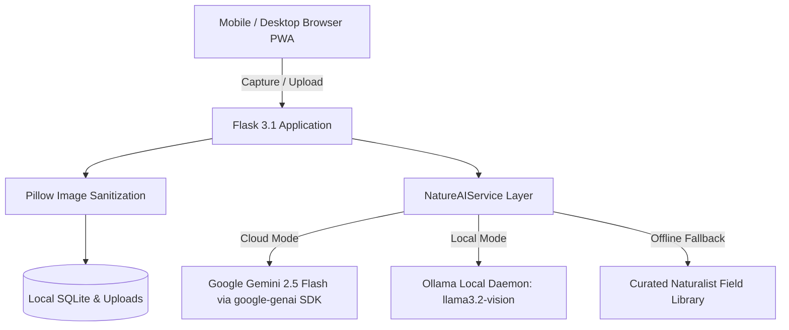

*This is a submission for the [Hacktoberfest Open-Source AI Challenge Week 1: Touch Grass](https://dev.to/challenges/hacktoberfest-week1-2026-10-05)*

---

## What I Built

Modern digital devices and algorithm-driven feeds are engineered to maximize screen time, pulling us away from the living ecosystems right outside our windows. 

**NatureLens AI** is an open-source nature exploration companion engineered to reverse that dynamic. Instead of keeping people trapped in conversational loops or endless feeds, NatureLens AI treats artificial intelligence as a temporary observation lens. Its central message is simple:

> **"Look closer. Discover nature. Touch grass."**

### Who Is It For?
NatureLens AI is designed for students, beginners, birdwatchers, hikers, gardeners, and urban explorers of all ages who want to learn about biodiversity in their backyards, local parks, and nature trails.

### Core Capabilities:
1. **Multimodal Nature Explorer**: Snap or upload photos of leaves, flowers, birds, insects, and plants. The AI analyzes visible physical anatomy (leaf venation, margins, plumage patterns, antennae) and delivers structured educational insights—while candidly stating identification limitations rather than inventing fake scientific certainty.
2. **Touch Grass Mission Generator**: AI-crafted, 10-to-60 minute micro-exploration challenges (e.g., *The Micro-Leaf Architecture Quest*, *Avian Songscape Listening Circle*, *10-Minute Pollinator Census*). The app encourages users to read the instructions, **pocket their phones**, complete the observation with their own eyes and ears, and log their reflections upon returning.
3. **Private Nature Journal**: A serverless local field notebook backed by SQLite. Users can record dates, general locations, photographs, and field notes, with real-time search, category filters, and one-click JSON data export.
4. **AI Nature Field Guide**: An ethical outdoor educator answering biodiversity questions while strictly enforcing the **"Leave No Trace"** naturalist code (discouraging nest disturbance, handling unknown stinging insects, or trampling fragile micro-soils).
5. **Authentic Outdoor Badges**: Milestones unlocked strictly through verified user actions (discoveries cataloged, missions completed, unique active days). Zero manipulative gamification, streaks, or artificial screen-time traps.
6. **Offline-First PWA Architecture**: Built with Progressive Web App (PWA) Service Worker caching and an offline naturalist library so it continues functioning deep in forest trails where cellular connectivity drops out.

---

## Demo

- **Live Repository**: [https://github.com/Pritam-Panigrahi/Plantcare_ai](https://github.com/Pritam-Panigrahi/Plantcare_ai)
- **Local Interactive Demo**: Clone the repository and run `python run.py` (or `.venv/bin/python run.py`) to launch the full-featured web app locally on `http://127.0.0.1:5000`.

### Key User Experience Walkthrough:
1. **Home / Ethos**: A responsive botanical interface (#2E7D32 primary green, #163A2A forest green, #F5F7F0 soft earth) showcasing biodiversity discovery cards and open-source principles.
2. **Explorer**: Upload or capture a specimen using mobile cameras (`capture="environment"`). The model inspects visible characteristics, returning habitat context, educational facts, and a suggested outdoor activity.
3. **Mission Mode**: Select an activity (walking, birdwatching, gardening, exploration), difficulty, duration, and environment to generate a custom outdoor mission with interactive checkable items.
4. **Journal & Badges**: Save discoveries with custom notes; earn verified milestone badges like *First Step Outdoors*, *Leaf Detective*, and *Touch Grass Initiate*.

---

## Code



- **GitHub Repository**: [https://github.com/Pritam-Panigrahi/Plantcare_ai](https://github.com/Pritam-Panigrahi/Plantcare_ai)
- **License**: [MIT License](https://github.com/Pritam-Panigrahi/Plantcare_ai/blob/main/LICENSE) (100% Free & Open-Source)

---

## How I Built It

### Architecture & Technology Stack
- **Frontend**: Responsive, mobile-first HTML5, CSS3, Vanilla JavaScript, Bootstrap 5, Bootstrap Icons, with custom nature design tokens.
- **Backend**: Python 3.11+, Flask 3.1 modular application factory with clean blueprint routing (`explorer`, `missions`, `journal`, `guide`, `progress`, `api`).
- **Database & Storage**: SQLite via Flask-SQLAlchemy for local persistence; Pillow (PIL) for image sanitization, format conversion, and mobile camera downscaling.
- **AI Engine (Dual-Mode Intelligence)**:
  - **Google Gemini API**: Integrated via the official `google-genai` Python SDK (`gemini-2.5-flash` primary multimodal model, `gemini-2.0-flash` fallback). Provides lightning-fast visual identification and intelligent mission synthesis.
  - **Local Open-Weight Models (Ollama)**: Supports local inference via Ollama HTTP REST API (`llama3.2-vision:11b`, `llama3.2:3b`, `llava:7b`) for users who desire zero external cloud dependencies.
  - **Curated Naturalist Library**: Provides high-quality botanical and zoological profiles when AI is offline, ensuring the app remains 100% useful without internet or API keys.
- **Testing**: 31 automated unit and integration tests using `pytest` covering upload validation, SQLite persistence, mock Gemini API calls, Ollama fallbacks, and security boundaries.

---

## Why Does Open Innovation Matter?

Open innovation and open-weight AI are uniquely vital for tools that interface with the physical environment:

1. **Absolute Privacy for Personal Media**: When users photograph their private backyards, balconies, or children examining a leaf, those photos should never be harvested to train closed commercial models. Open innovation allows users to choose completely local execution.
2. **Model Sovereignty & Flexibility**: By decoupling the UI from proprietary vendor locks, users can switch between Google Gemini (`gemini-2.5-flash`) for cloud inference, local open weights (`llama3.2-vision`, `llava`) on their own GPUs, or lightweight offline libraries.
3. **Zero Financial Barriers to Nature Education**: Nature education should be free and accessible to students, schools, and community groups without recurring paywalls or token limits.
4. **Resilience Beyond Cell Towers**: True nature exploration happens deep in forests, canyons, and parks where cellular signals fail. Open-weight models and offline-first PWA caching ensure the app remains fully functional off-grid.

---

## My Agent Session

This project was built pair-programming with **Antigravity** (Google DeepMind's Advanced Agentic Coding system). 

During the session, the agent:
- Scaffolded the complete full-stack Flask architecture, SQLite models, and botanical UI design system.
- Integrated the official `google-genai` Python SDK for multimodal Gemini 2.5 Flash inference.
- Implemented robust error handling for API quotas, invalid keys, and network timeouts.
- Configured local open-weight Ollama compatibility and offline PWA service worker caching.
- Authored a comprehensive test suite of 31 unit and integration tests with 100% pass rate.

---

## Prize Categories

- **Primary Submission**: Hacktoberfest Open-Source AI Challenge — Week 1: "Touch Grass"
