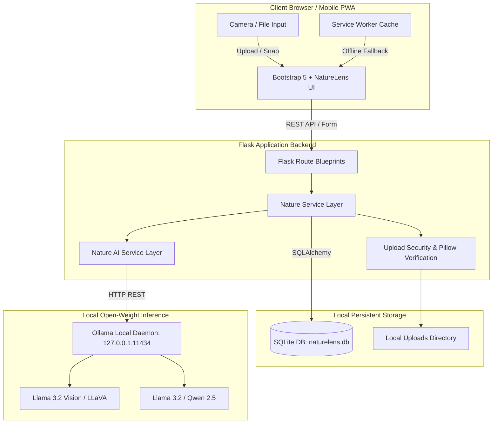

# NatureLens AI 🌿

> **"Look closer. Discover nature. Touch grass."**  
> An open-source, local-AI nature exploration companion built for the **Hacktoberfest Open-Source AI Challenge (Week 1: "Touch Grass")**.

[](LICENSE)
[](https://www.python.org/)
[](https://flask.palletsprojects.com/)
[](https://ollama.com/)
[](tests/)

---

## 📖 Overview & Problem Statement

Modern computing technology continually pulls people into prolonged screen time, algorithmic feeds, and digital isolation. While artificial intelligence is often deployed to increase digital screen engagement, **NatureLens AI** inverts this relationship.

NatureLens AI acts as a temporary observation lens. Rather than trapping users in an endless chat loop, it encourages users to step outside, photograph wild plants, birds, insects, and leaves in their local parks or backyards, receive **100% private, local open-weight AI identification**, complete physical outdoor exploration missions, and then **put their screens away to touch grass**.

---

## ✨ Key Features

- 📷 **Local AI Nature Explorer**: Upload or take photos directly on mobile devices. Local vision models inspect visible anatomy, leaf margins, and plumage without sending private media to corporate clouds.
- 🧭 **Touch Grass Mission Generator**: AI-crafted, 10-to-60 minute micro-exploration challenges with interactive observational checklists, safety guidelines, and reflection questions.
- 📖 **Personal SQLite Nature Journal**: Searchable, filterable local logbook of observations, field notes, locations, and photos. Includes one-click JSON backup export.
- 🌿 **AI Nature Field Guide**: Ethical educational conversation interface explaining biodiversity, pollinator ecology, and bird songs with strict "Leave No Trace" boundaries.
- 🏆 **Outdoor Exploration Badges**: Milestone tracking grounded strictly in verified actions (discoveries logged, missions completed, unique active days). Zero dark patterns or manipulative streaks.
- 📶 **Offline-First PWA Architecture**: Built with Service Worker caching and an offline naturalist knowledge base. Continues functioning deep in wooded trails where cell towers cannot reach.

---

## 🏗️ Architecture Diagram



---

## 💻 Technology Stack

| Layer | Technology | Purpose |
|---|---|---|
| **Frontend** | HTML5, CSS3, Vanilla JavaScript, Bootstrap 5, Bootstrap Icons | Responsive, mobile-first nature UI with botanical design tokens |
| **PWA / Offline** | Service Worker (`sw.js`), Web App Manifest | Asset caching and offline trail resilience |
| **Backend** | Python 3.11+, Flask 3.1, Flask-SQLAlchemy, Werkzeug, Pillow | RESTful architecture, image sanitization, database persistence |
| **Database** | SQLite | Serverless, zero-configuration local database |
| **AI Engine** | [Ollama](https://ollama.com/) Local HTTP API | Open-weight model execution with zero cloud dependency |
| **Vision Model** | `llama3.2-vision:11b` (Fallback: `llava:7b`) | Botanical and zoological image understanding |
| **Text Model** | `llama3.2:3b` (Fallback: `qwen2.5:3b`) | Educational Q&A and outdoor mission generation |
| **Testing** | pytest (24 unit & integration tests) | Automated test suite runnable without active GPU/Ollama |

---

## 🧠 Open-Weight Model Selection & Licenses

| Role | Recommended Model | Minimum VRAM / RAM | License |
|---|---|---|---|
| **Vision-Language** | `llama3.2-vision:11b` | 8GB - 12GB VRAM | Llama 3.2 Community License |
| **Vision (Lightweight)** | `llava:7b` | 4GB - 6GB VRAM | LLaVA Research / Apache 2.0 |
| **Text Generation** | `llama3.2:3b` | 2GB - 4GB RAM | Llama 3.2 Community License |
| **Text (Alternative)** | `qwen2.5:3b` | 2GB - 4GB RAM | Apache 2.0 |

*Note: NatureLens AI never uses proprietary closed APIs (OpenAI, Gemini, Claude) as primary intelligence. When Ollama is offline or hardware lacks sufficient memory, NatureLens gracefully activates its built-in curated naturalist library with full transparency.*

---

## 🚀 Quickstart Installation Guide

### Prerequisites
- Python 3.11 or newer installed.
- (Optional for live AI inference) [Ollama](https://ollama.com/) installed and running.

---

### Step 1: Clone Repository & Create Virtual Environment

#### macOS / Linux
```bash
git clone https://github.com/your-username/naturelens-ai.git
cd naturelens-ai

# Create virtual environment
python3 -m venv .venv
source .venv/bin/activate

# Install dependencies
pip install -r requirements.txt
```

#### Windows (PowerShell)
```powershell
git clone https://github.com/your-username/naturelens-ai.git
cd naturelens-ai

# Create virtual environment
python -m venv .venv
.venv\Scripts\Activate.ps1

# Install dependencies
pip install -r requirements.txt
```

---

### Step 2: Configure Environment Variables
```bash
# Copy the example environment file
cp .env.example .env
```
Default `.env` configuration:
```env
FLASK_ENV=development
FLASK_APP=run.py
SECRET_KEY=change-this-in-production
OLLAMA_BASE_URL=http://127.0.0.1:11434
OLLAMA_VISION_MODEL=llama3.2-vision:11b
OLLAMA_VISION_MODEL_FALLBACK=llava:7b
OLLAMA_TEXT_MODEL=llama3.2:3b
DEMO_MODE_ALLOWED=true
```

---

### Step 3: (Optional) Setup Ollama Models

If you wish to run live local AI inference on your machine:
```bash
# Start Ollama daemon in background or open the Ollama app
ollama serve

# Pull the recommended models:
ollama pull llama3.2-vision:11b
ollama pull llama3.2:3b

# If your machine has under 8GB GPU memory, pull the lightweight vision model instead:
ollama pull llava:7b
```
*(If you do not have Ollama installed or are on modest hardware, the app automatically runs in Offline Naturalist Library mode with full access to exploration missions and journal features!)*

---

### Step 4: Run the Application
```bash
python run.py
```
Open your browser and navigate to:
```
http://127.0.0.1:5000
```

---

## 🧪 Running Automated Tests

The test suite validates all application layers, including image sanitization, upload validation, SQLite CRUD, CSRF protection, and mocked AI inference timeouts:

```bash
# Run all tests using pytest
pytest -v
```

Expected test result:
```
============================== 24 passed in 1.59s ==============================
```
*Tests run entirely in-memory and do not require Ollama or an active GPU.*

---

## 🔒 Privacy & Offline Considerations

1. **Zero External Telemetry**: Images, GPS coordinates, notes, and questions never leave your computer.
2. **Ephemeral Inference**: Images are sent to your local Ollama port (`127.0.0.1:11434`) and are not cached or stored by external cloud providers.
3. **Local Storage**: Journal entries and badges are stored locally in `./instance/naturelens.db`.
4. **Offline Capability**: When exploring trails without cell reception, previously viewed pages and saved journal entries remain accessible via the Service Worker cache.

---

## 📋 Ethical Nature Exploration Guidelines

NatureLens AI adheres strictly to the **Outdoor Naturalist Code**:
- 🌿 **Leave No Trace**: Pack out whatever you pack in.
- 🐦 **Do Not Disturb Wildlife**: Never approach active nests, burrows, or feeding young.
- 🚫 **No Touching Unknown Species**: Observe stinging insects, toxic caterpillars, and unfamiliar fungi visually without touching.
- 📵 **Screen Boundaries**: Read your mission instructions, pocket your phone, and observe with your human senses.

---

## 🤝 Contributing

Contributions are welcome! Please follow these steps:
1. Fork the repository.
2. Create your feature branch (`git checkout -b feature/NewOutdoorChallenge`).
3. Commit your changes (`git commit -m 'Add new micro-habitats challenge'`).
4. Ensure all 24 pytest tests pass (`pytest`).
5. Push to the branch (`git push origin feature/NewOutdoorChallenge`).
6. Open a Pull Request.

---

## 📜 License

This project is licensed under the **MIT License** — see the [LICENSE](LICENSE) file for details.
